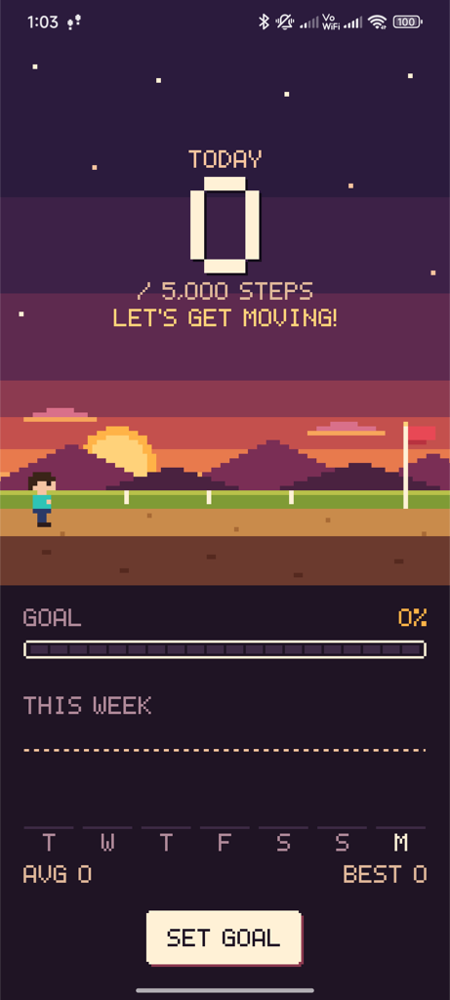

# StepsCounter

A clean, highly accurate, privacy-first Android step counter app built with Kotlin and Jetpack Compose.

## Features
- **High Accuracy:** Counts from the phone's hardware step counter. Steps taken while the app was closed are recovered the same day, and reboots and midnight are handled.
- **100% Offline & Private:** No accounts, no data harvesting. All step data is stored locally on your device.
- **Battery Efficient:** Listens only to the low-power `Sensor.TYPE_STEP_COUNTER`, with no wakelocks, polling or extra sensors, so the CPU can sleep while the step chip counts.
- **Pixel-art UI:** A sunset scene where a little walker heads for your goal flag as you step, with a blocky goal bar, a 7-day chart and a custom pixel font, all drawn in Jetpack Compose.

## Requirements
- Android 8.0 (API 26) or higher; Android 13+ recommended. Needs `ACTIVITY_RECOGNITION`; `POST_NOTIFICATIONS` is optional (it shows the live count).
- A physical Android device with hardware step sensors (cannot be fully tested on an emulator).

## Tech Stack
- **Language:** Kotlin
- **UI:** Jetpack Compose
- **Background Logic:** Android Foreground Services
- **Storage:** SharedPreferences

## Getting Started
1. Clone the repository.
2. Open the project in Android Studio.
3. Build and run the app on a physical Android device.
4. Accept the required physical activity permissions.
5. Set your daily goal and start walking!

## Background Counting
Some phones stop background apps to save battery. If the in-app card **Keep counting in the background** appears, follow it:
- **Unrestricted battery:** keeps the battery saver from stopping step counting.
- **Autostart (Xiaomi / Redmi / POCO):** without it, HyperOS/MIUI won't restart counting after the app is killed, the phone reboots or the app is updated.

## Development
- Run the step-accounting unit tests with `./gradlew testDebugUnitTest`.
- Gradle 8.13 needs JDK 17–21 (`JAVA_HOME`); it doesn't run on JDK 25.
